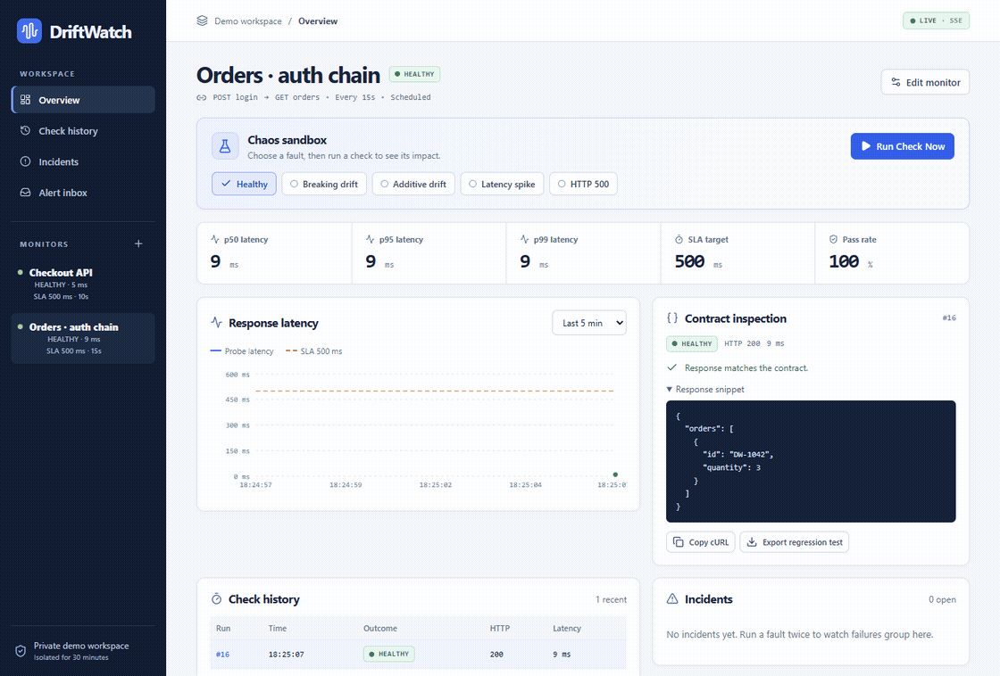

# DriftWatch

**Catch a deployed API changing under its clients.** Flip a fault in a private checkout sandbox and follow one real request from login to orders, through a JSON contract diff, to a deduplicated incident and its alert delivery.

**[Live Demo](https://drift-watch-two.vercel.app)** · Hosted on Vercel Hobby + Render Free + Neon Free (first load after 15 min idle includes a Render cold start). **[20-Second Demo GIF](docs/media/driftwatch-demo.gif)** · Recorded from the local Docker stack.



## 30-second interactive demo guide

1. Open the dashboard and select **Orders · auth chain**. **LIVE · SSE** confirms that the browser has connected.
2. Choose **Breaking drift → Run Check Now**. Inspect `$.orders[0].quantity`. The contract expects an integer and the captured response contains the string `"3"`.
3. Click **Run Check Now** again. Open **Incidents**, then **Alert inbox**. The failure count rises while the inbox contains one OPENED delivery for that fingerprint.
4. Choose **Healthy → Run Check Now** for one RESOLVED delivery. Try **Latency spike** in Overview to see a sample cross the 500 ms SLA line.

Select an older run in **Check history** to copy a Bash cURL reproduction (jq extracts the short-lived login token) or download a Vitest/Ajv regression test. Each visitor gets two sandbox monitors in a 30-minute workspace. The form shows the server's SSRF verdict for external URLs. Operator authorization is required to schedule external probes.

## Run locally

From the repository root, with Docker Desktop or Docker Engine and Compose v2 running:

```sh
docker compose up --build
```

Open **http://localhost:3000**. Compose starts PostgreSQL 16, applies checksum-verified migrations, seeds fixtures and starts the dashboard, API, worker and sandbox. `docker compose down` stops the stack. The named volume keeps your data.

## Architecture

```text
 Vercel static UI (optional)             React/Vite UI served by Fastify
      | same-origin rewrites                      |
      +--------------------+----------------------+
                           v
  Browser <---- SSE ---- Fastify API ---- monitor registry / manual run
                           |                         |
                           |                         v
                           |                 leased probe worker
                           |                  |             |
                           |           fixed sandbox     public endpoint
                           |           login -> orders   DNS + pinned IP
                           |                  |             |
                           |                  +------+------+
                           |                         v
                           |               Ajv diff + SLA check
                           v                         |
                   PostgreSQL <----- fenced completion transaction
                 jobs / results / incidents / deliveries / event cursor
```

`RUN_MODE=all` is the default single-service deployment. The same binary also supports `api`, `worker` and `sandbox`. In split mode, configure `SANDBOX_ORIGIN` on the API and worker and use the same database. A shared `SANDBOX_TOKEN_SECRET` supports multiple sandbox replicas.

## Key engineering decisions and trade-offs

| Decision | What it buys | Cost or boundary |
| --- | --- | --- |
| PostgreSQL queue with `FOR UPDATE SKIP LOCKED` | Concurrent workers claim disjoint rows without Redis. A lease token fences the result transaction. | A crashed worker can repeat the HTTP read after expiry. Only the current unexpired lease can commit. |
| SQL `PERCENTILE_CONT` | p50, p95 and p99 use the same indexed monitor/time window across processes. | Exact percentiles sort the matching samples. Windows and history are bounded. |
| Partial unique index on open incident fingerprints | Repeated failures increment one row. The delivery key admits one OPENED and one RESOLVED record per incident. | An incident can recur after resolution. The inbox is a durable local sink; external webhook delivery is a separate adapter. |
| DNS validation plus a pinned socket destination | Every resolved public address is checked at registration and again on connection. Host/TLS name is preserved. | Public targets use default HTTP(S) ports, no redirects and a bounded response. Internal fixtures use a separate enum-based capability. |
| Durable event table and SSE | A browser can resume with Last-Event-ID after a disconnect; API and worker can run separately. | The API polls for committed events. On reconnect the UI also reloads its snapshot. Replay is limited to retained rows. |

## Runtime hardening

- `/health` performs a database round trip for database-backed roles. An unavailable or unconfigured database returns HTTP 503. Standalone sandbox reports its database as optional.
- `AUTO_SEED_DEMO=true` seeds an empty operator registry on boot under a transaction lock. Repeated starts preserve edits. Standalone `npm run db:seed` explicitly ensures the two fixtures exist.
- Every worker starts a sweeper; a PostgreSQL advisory lock selects one sweep at a time. It removes aged probe results, stream events, deliveries and resolved incidents. It preserves open incidents. The default is 7 days and at most 25,000 retained rows per eligible table, with 1,000 deletions per table per batch. Sweeps check every minute and drain a backlog in short batches. Expired demo sessions also get removed. Normal FK cascades remove dependent records.
- Mutations are rate-limited per client IP and API process. The default budget is 60 per minute, with HTTP 429 and Retry-After. Read traffic and SSE heartbeats remain available. `TRUST_PROXY_HOPS` defaults to 0; set it only when the deployment has a known and enforced proxy path.
- History caps bound retained rows after cleanup. PostgreSQL storage also includes indexes, large payloads, WAL and live records. Monitor provider storage and compute usage; row caps alone cannot guarantee a byte quota.

## Verification

| Command | What runs |
| --- | --- |
| `npm ci && npm run typecheck && npm run build` | Strict compilation across the workspaces and a production web build |
| `npm run test:unit` | DB-independent engine, fingerprint and transport/SSRF checks |
| `npm test` | Build, backend smoke/embedded SQL and frontend Vitest utilities |
| `docker compose run --build --rm verify` | One-command live PostgreSQL E2E, including cold boot, exact three-failure dedup, HTTP/SSE, retention, concurrency and Linux SIGINT/SIGTERM |
| `npm run verify-e2e` | Same DB suites from a built checkout with DATABASE_URL set; POSIX signal tests run on Linux |
| `npm run test:browser` | Real UI, API and DB; fail on browser console/page errors, validate actual clipboard cURL with Bash and downloaded JS with Node |

For host-based E2E use Node 22.12+, a disposable PostgreSQL database with CREATE SCHEMA permission and a built checkout. Each suite creates and drops a randomly named schema. For the browser suite install Chromium with `npx playwright-core install chromium` or set `CHROMIUM_EXECUTABLE_PATH` to Chrome/Edge. Install Bash or set `BASH_PATH` to its executable. CI includes both the Linux and headless browser gates.

## Deploy a free-tier portfolio demo

1. **Neon.** Create a Free project and a PostgreSQL database. Copy the direct connection string, including the provider's TLS query parameters. Store it as the Render secret `DATABASE_URL`. The database role must own or be able to migrate the application schema. [Neon Free plan](https://neon.com/pricing)
2. **Render.** Import the repository-root `render.yaml` Blueprint as a Free Docker web service. Set `DATABASE_URL` and `CORS_ORIGIN` to the intended Vercel HTTPS origin (scheme and hostname, no trailing slash). The Blueprint generates `OPERATOR_TOKEN` and supplies the settings below. Its start command applies migrations under an advisory lock and execs Node as PID 1. Check `https://<render-host>/health` for HTTP 200 and `database=connected`. The Render URL already serves the dashboard. [Blueprint reference](https://render.com/docs/blueprint-spec) · [Free service limits and cold starts](https://render.com/docs/free)
3. **Vercel.** Set project root to the repository root, Node to 22.x and use the checked-in `vercel.json`. Replace **all three** occurrences of `replace-with-render-host.invalid` with the assigned Render hostname before deploying. Build is `npm run build` and output is `apps/web/dist`. The browser uses same-origin paths. Vercel forwards API/SSE, sandbox reproduction URLs and health checks to Render. No frontend environment variables or credentials are required. [External rewrites](https://vercel.com/docs/rewrites) · [Hobby plan](https://vercel.com/docs/plans/hobby)
4. **Public acceptance.** Open a fresh browser profile, repeat the 30-second guide, then open another private window to verify isolation. Disconnect/reconnect and check LIVE plus history reconciliation. Measure cold and warm loads separately. After passing, replace the live URL slot at the top of this README.

| Render environment | Value |
| --- | --- |
| DATABASE_URL | Secret Neon PostgreSQL URI with TLS |
| CORS_ORIGIN | Exact Vercel HTTPS origin; a comma-separated list supports additional trusted origins |
| OPERATOR_TOKEN | Generated secret for operator writes |
| NODE_ENV / RUN_MODE | `production` / `all` |
| AUTO_SEED_DEMO / COOKIE_SECURE | `true` / `true` |
| PORT | Provided by Render; Node binds 0.0.0.0 |
| SANDBOX_ORIGIN | Leave unset in combined mode to derive loopback from PORT |
| RETENTION_DAYS / RETENTION_MAX_ROWS / RETENTION_BATCH_SIZE | Defaults `7` / `25000` / `1000` |
| RATE_LIMIT_MAX / TRUST_PROXY_HOPS | Defaults `60` / `0` |

Scheduled probes run while the service is awake. A sleeping Render service has a cold start, and persistent polling consumes Neon compute. Keep the optional health ping disabled for the default free-tier configuration. To opt in, set repository variables `ENABLE_KEEP_ALIVE=true` and `DRIFTWATCH_HEALTH_URL=https://<render-host>/health`, then uncomment the 14-minute cron schedule in `.github/workflows/keep-alive.yml`. Scheduled Actions can be delayed.

**Rollback & maintenance.** Redeploy the preceding compatible image/commit. Migrations are append-only. For a database rollback, restore a backup or branch and point DATABASE_URL at it before redeploying. See [the backlog](docs/BACKLOG.md) for completed milestones and [the maintenance plan](docs/MAINTENANCE.md) for operating cadence, incident response, and backlog prioritization.
